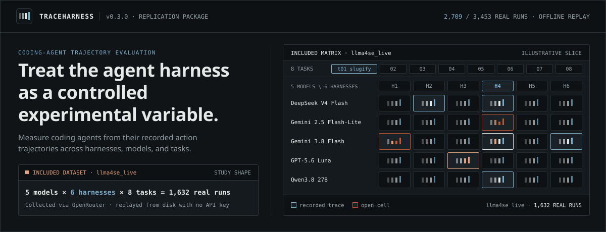
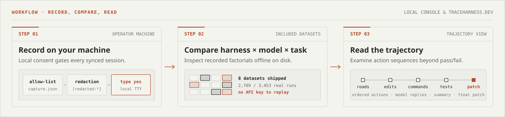

[](https://codespaces.new/aura-lab-wm/traceharness)

**TraceHarness** measures coding agents from their trajectories and treats the harness as an experimental variable. This repository is the replication and teaching package for the evaluation lab: it bundles the local console, the session-capture CLI, recorded multi-harness datasets, and step-by-step lab exercises for loading and analysing 1,000 real SWE-agent trajectories at <https://traceharness.dev/guide/> (also in [`docs/GUIDE.md`](docs/GUIDE.md), [`docs/STUDENT_GUIDE.md`](docs/STUDENT_GUIDE.md), [`docs/CODESPACES.md`](docs/CODESPACES.md), `HANDOUT.md`, and `LAB_1H.md`). Open it directly in GitHub Codespaces with the badge above; an OpenRouter key is needed only when running new experiments against live models.



## Check that it works

Run the offline self-check (about ten seconds, no API key):

```bash
python scripts/check_install.py      # or: make check
```

Expect `All 5 checks passed`. The deterministic mock agent must score **exactly `14 / 24`**; any other score indicates a broken grader (see [`docs/STUDENT_GUIDE.md`](docs/STUDENT_GUIDE.md), section 13).

## Run the dashboard

Python 3.10 or newer is required (**Python 3.12** recommended). On macOS, the built-in `python3` is 3.9 and fails to install this package—install Python 3.12 from python.org or Homebrew and substitute `python3.12` below. From this checkout or the extracted `traceharness-school` directory:

```bash
python3 -m venv .venv
source .venv/bin/activate
python3 -m pip install -e .
python3 -m traceharness --no-browser
```

Open **http://127.0.0.1:8765**. No API key is needed to inspect the included results. Prebuilt frontend assets (`traceharness/frontend/dist`) ship in the repository, so Node.js is required only if you modify frontend source.

The UI opens on **Datasets**, listing every directory under `data/runs/` (the included datasets below plus any runs you generate locally). Optional guided teaching notes beside each attempt can be enabled under **Settings → Student Lab · Guided Analysis**. When distributing the teaching handoff, share the built `dist/traceharness-school.zip` archive, which physically omits excluded local data.

## Container and Compose

To run via Docker without a local Python environment (works identically from a git checkout or an extracted `traceharness-school` archive, even if `.venv` exists beside it):

```bash
docker build -t traceharness:school .
docker run -d --rm -p 127.0.0.1:8765:8765 --name traceharness traceharness:school
```

Open **http://127.0.0.1:8765**. The image contains only the datasets listed below, and runs launched inside it default to the bundled mock model (requiring no key) regardless of the build machine's local model selection.

Or run with Docker Compose:

```bash
docker compose up --build
```

Compose bind-mounts `./data/runs` into the container so new runs persist on disk across `docker compose down` (in a developer checkout, the container also sees any other directories already present in `data/runs/`). Set `OPENROUTER_API_KEY` in your shell or a `.env` file beside `docker-compose.yml` for live model sweeps; without it, pre-recorded datasets and the mock provider continue to work.

Both container setups bind to `127.0.0.1` only by default. To reach the server from another LAN host, set `TRACEHARNESS_ALLOWED_HOSTS` to the extra `Host` header(s) the backend should accept (defaults: `127.0.0.1`, `localhost`, `[::1]`).

## Record on traceharness.dev

Sign in at [traceharness.dev](https://traceharness.dev), then connect the machine where your coding agents run. Local capture adapters support **Claude Code**, **Codex**, **Gemini CLI**, **Qwen Code**, and **Cursor**. These commands use the CLI without starting a local web server:

```bash
pipx install git+https://github.com/aura-lab-wm/traceharness
traceharness login
traceharness capture --watch --sync --path /path/to/chosen/session-directory
```

`traceharness login` prints a short device code and `https://traceharness.dev/app/device`. Open that URL in an already signed-in browser, verify the code, and press **Approve**. No browser opens automatically. The token is saved to `~/.traceharness/credentials.json` (mode `0600`, owner-only) and is sent exclusively in an `Authorization` header to the host you signed in to. Run `traceharness whoami` to inspect the active account. See [`docs/CAPTURE_SYNC.md`](docs/CAPTURE_SYNC.md) for setup details and verification limits.

**Claude Code plugin** (requires the `pipx` install above; attempts an upload when an allowed session exits):

```bash
claude plugin marketplace add aura-lab-wm/traceharness
claude plugin install traceharness-capture@traceharness
```

On session exit, the `SessionEnd` hook (60-second hook limit; 45-second upload subprocess timeout) runs `traceharness capture push --source claude_code --session-file <transcript> --quiet`. It exits `0` with no output if `traceharness` is absent or signed out, and failed uploads do not retry automatically.

- **What is recorded.** Each session's ordered action list (reads, edits, commands, test runs, model replies), a summary, and the final patch. Uploaded runs appear under *Connect this computer* at `/app/capture`, where you can inspect or delete any run.
- **Explicit terminal consent (`type yes`).** `--watch --sync` requires a person to type `yes` at an interactive terminal and refuses `--yes` and noninteractive input. The website and linked pages cannot start capture. The optional `SessionEnd` plugin operates strictly within your local allow-list and saved login.
- **Allow-list.** Only sessions inside folders you explicitly allow are read or sent. Persistent rules live in `~/.traceharness/capture.json` (editable from the Capture page of `traceharness serve`), while `--path DIR` authorizes one folder for a single invocation. A missing or unreadable `capture.json` allows nothing.
- **Redaction limits.** Before upload, known API keys and tokens (Anthropic, OpenAI, OpenRouter, GitHub, AWS, Google, Slack, Supabase, Stripe, Hugging Face, npm, TraceHarness), JWTs, `Bearer` tokens, URL `user:password` segments, private-key blocks, `password=`/`secret=`/`api_key=`/`refresh_token=` values, and string values under JSON keys containing `password`, `secret`, `token`, `api key`, `authorization`, or `credential` are replaced with `[redacted:<kind>]`. Redaction is pattern-based and cannot know every secret format (a password written as plain prose, or an unusual token shape, passes through), so read a run before you share it if it may hold something unusual. Inspect outbound payloads locally with `traceharness capture push --dry-run`. Runs exceeding 4 MiB are skipped and reported.
- **Optional outbound link.** `traceharness link --member` opens an outbound watch-only connection under your sign-in, binds no local port, refuses `--accept-commands`, and disables `run` and run-directory streaming (`live`/`tail`). Live streaming of captured sessions is unimplemented; `/app/capture` displays stored runs.
- **Pause or revoke.**

```bash
traceharness logout            # revokes this computer's token and deletes it; sends nothing afterwards
traceharness capture --pause   # stops the watcher and `capture push` (including the Claude Code hook); `--resume` undoes it
```

The Claude Code hook respects the allow-list, sign-in state, and `--pause`. You can also revoke tokens and delete uploaded runs from `/app/capture` at any time.

## Local server security

The local server binds to `127.0.0.1` by default and applies two request checks ahead of every route:

- **Host allow-list.** Requests whose `Host` header is outside `127.0.0.1`, `localhost`, `::1`, an explicit `--host` address (excluding `0.0.0.0` and `::`), or comma-separated hosts in `TRACEHARNESS_ALLOWED_HOSTS` (for example `TRACEHARNESS_ALLOWED_HOSTS=my-host.example` behind a reverse proxy or container hostname) are rejected. This blocks DNS-rebinding requests originating from a browser tab.
- **Same-origin writes.** `POST`, `PUT`, `PATCH`, and `DELETE` requests carrying a cross-origin `Origin` or `Sec-Fetch-Site` header are rejected, and write requests must declare `Content-Type: application/json`. This blocks cross-site request forgery (CSRF) from other open tabs.

**Single-machine boundary.** These checks protect against a hostile web page in your browser; they provide no isolation against other users or processes on the same machine. Any local user, process, or port-forward reaching `127.0.0.1` on the server port has the same access as the browser UI. Add authentication in front of the server before exposing it past `127.0.0.1` or a trusted LAN.

## Included datasets

| Dataset | Runs | Source |
| --- | ---: | --- |
| `llma4se_live` | 1,632 | **Real.** Five models (DeepSeek V4 Flash, Gemini 2.5 Flash-Lite, Gemini 3.8 Flash, GPT-5.6 Luna, Qwen3.8 27B) × six harnesses × 8 tasks, collected for this lab through OpenRouter. Default for exercises 1–6 and 8. |
| `live` | 576 | **Real.** Claude Haiku 4.5, Gemini 2.5 Flash, GPT-5-mini × eight harnesses × 8 tasks, collected for this lab through OpenRouter. Second input to exercise 8. |
| `real_swe_agent_500` | 500 | **Real, third-party.** SWE-agent (Llama 8B / 70B) on 30 GitHub issues, from [nebius/SWE-agent-trajectories](https://huggingface.co/datasets/nebius/SWE-agent-trajectories) (CC-BY-4.0). Used by `ex7 --offline`. |
| `prerecorded_mock` | 480 | Mock model × six harnesses × 8 tasks — deterministic baseline identical on every machine. |
| `prerecorded_mock_weak` | 160 | Weaker mock model — the 2 × 2 mock version of exercise 8. |
| `families_mock` | 80 | Two mock models × four harnesses × 5 tasks. |
| `demo_mock` | 24 | Compact mock demonstration. |
| `captured_claude_code` | 1 | **Real, captured.** One Claude Code session (Claude Sonnet 5, 28 steps) implementing `results_scope.py` and its test in this repository (nine test runs, tested before exit). Recorded by the capture pipeline with machine paths normalized to `/workspace/traceharness`: an organic session with no oracle, one repeat, and an unchosen harness. |

2,709 of the 3,453 included runs are real model runs. All included runs replay from disk with no API key; an OpenRouter key is needed only to execute new runs against live models.

## Reproduce the exercises

From the repository root after installation:

```bash
python3 exercises/ex1_variance.py
python3 exercises/ex2_harness.py
python3 exercises/ex7_real_trajectories.py --offline
python3 exercises/ex8_experiment.py
```

See `HANDOUT.md` for exercises 3–6 and analysis questions (`matplotlib` is optional for plotting). To execute a new offline mock run:

```bash
python3 -m traceharness run --provider mock --tasks t01_slugify --repeats 3 --out data/runs/mine
```

New run directories appear on the dashboard alongside the included datasets. To ship a new dataset in the school archive, add it to `traceharness/school-package.json` and rebuild.

## Contents and exclusions

**Included:** application source and prebuilt UI (`traceharness/frontend/dist`), lab exercises, task repositories, harness configurations, trajectory checks, infrastructure tests, attribution, and the eight datasets above (with the bundled mock sentinel model selected independently of local machine configuration).

**Excluded from the school archive:** unlisted `data/runs/` directories, local captured-session stores and watcher state (only the single curated session above ships), credentials, environment files, caches, local model selection, personal outputs, Git history, the macOS menu-bar app, machine census tools, internal notes, and instructor solutions. Optional corpus/tooling integration tests require the full checkout. `PACKAGE_MANIFEST.json` records each shipped file's relative path, size, and SHA-256 checksum (excluding itself) as selected by `traceharness/school-package.json`.

**Maintainer archive build:** run `python3 scripts/build_school_package.py --verify` (or `make school-package`) to build and clean-room verify `dist/traceharness-school.zip` (runs the four core exercises, a live mock run, the shipped tests, SHA-256 checks, and a path/secret scan; rejects symlinks, caches, hidden files, dropped tracked files, and non-zero exits). If you change frontend source, rebuild and stage `dist/` first (`cd traceharness/frontend && npm ci && npm run build && cd ../.. && git add traceharness/frontend/dist`), or restore tracked assets with `git checkout -- traceharness/frontend/dist && git clean -fdq traceharness/frontend/dist`.

**Further documentation:** [`docs/EXPERIMENT_WORKSPACE.md`](docs/EXPERIMENT_WORKSPACE.md) (signed-in harness editor, forked runs, and OpenRouter sweeps), [`docs/EXECUTION_PERFORMANCE.md`](docs/EXECUTION_PERFORMANCE.md), [`docs/COMPREHENSIVE_VERIFICATION.md`](docs/COMPREHENSIVE_VERIFICATION.md), [`docs/ASTRA_REVIEW_FIXES.md`](docs/ASTRA_REVIEW_FIXES.md) (seven repaired review findings), [`docs/CAPTURE_PRODUCTION_VERIFICATION.md`](docs/CAPTURE_PRODUCTION_VERIFICATION.md) (production uploads and two-member isolation), [`docs/EIGHT_SOL_PLATFORM_AUDIT.md`](docs/EIGHT_SOL_PLATFORM_AUDIT.md) (twelve platform audit repairs), [`docs/VOICE_TOUR_AND_BUDDY.md`](docs/VOICE_TOUR_AND_BUDDY.md) (narrated tour and Ask Buddy), and [`docs/ACCOUNT_PLATFORM_DESIGN.md`](docs/ACCOUNT_PLATFORM_DESIGN.md) (undeployed account/MFA/admin design proposal).

## How to cite

If you use TraceHarness in academic work, cite the software and the version used (`CITATION.cff` powers GitHub's **Cite this repository** button):

```bibtex
@software{mastropaolo2026traceharness,
  author  = {Antonio Mastropaolo},
  title   = {{TraceHarness}: Treating the Agent Harness as a Controlled Experimental Variable},
  year    = {2026},
  version = {0.3.0},
  url     = {https://traceharness.dev}
}
```

Plain text: Mastropaolo, A. (2026). *TraceHarness: Treating the agent harness as a controlled experimental variable* (Version 0.3.0) [Computer software]. https://traceharness.dev

If you use the 500 runs in `data/runs/real_swe_agent_500`, also cite Nebius, [SWE-agent-trajectories](https://huggingface.co/datasets/nebius/SWE-agent-trajectories) (CC BY 4.0).

## License

MIT for the software (see [`LICENSE`](LICENSE)); the Nebius trajectories in `data/runs/real_swe_agent_500/` stay CC-BY-4.0 and fall outside the MIT grant.
