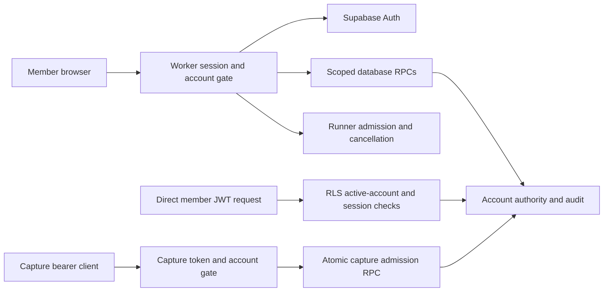

# Accounts and owner administration

Design proposal, November 11, 2026. This describes proposed behavior, not deployed features. The current signup gate, owner access, passwords, roles, cookies and database policies have not been changed by this design.

## Direction and launch decision

Keep Supabase Auth as the identity provider and build account administration into the existing signed-in surface at `/app/admin`, with personal security at `/app/account`. Use the existing Worker `/app/*` and `/api/*` routing. An admin console must operate through scoped server actions, not expose database queries, deployment credentials or a remote shell.

Recommended launch policy: **request access, then owner approval**. Approval issues an invitation; the recipient verifies their email and chooses their own password. The operator does not create, view or exchange end-user passwords. Public requests can scale independently of granting execution access. This recommendation is pending the operator's answer; it does not open registration.

Considered alternatives:

| Approach | Use and tradeoff |
| --- | --- |
| Owner-approved requests | Recommended first release; public discovery with controlled activation |
| Invitation only | Small private groups; little abuse exposure, but owner bottleneck |
| Verified self-service | Fast onboarding; needs abuse controls, execution entitlements and capacity limits first |
| Verified signup with approval only for execution | Lets people explore immediately; adds distinct membership and execution states |
| Institutional/domain admission | Useful for classes; excludes independent researchers and domain alone must not confer privilege |
| Organization SSO | Useful later for organizations; larger provisioning and recovery surface |
| Managed identity migration | A separate provider can reduce some operational work; migration and session invalidation risk do not justify switching before validating Supabase's existing capabilities |

For now, the product is one platform with owner/admin/member roles. Organizations, enterprise SSO, billing and delegated content access are future decisions rather than invented capabilities in the first release.

## Current findings that shape the design

- The Worker derives administrator status from `ADMIN_EMAILS`; database RLS derives it from `profiles.role`. These must become one authority before role management is offered.
- The November 11 inspection recorded a production signup trigger with a hard-coded email roster, absent from repository migrations. This is dated inspection evidence, not a fresh configuration check. Normal access-request approval does not update that roster, and it can reject privileged account creation too. Replace this deliberately; do not simply remove the gate.
- Request approval, Auth identity creation and activation are separate effects. An approved request is not proof that its account exists or its invitation was delivered.
- The current `th_session` cookie holds a Supabase JWT and has a one-hour cookie lifetime; this does not establish the upstream JWT lifetime. There is no application refresh/session registry. Preserve its HttpOnly, Secure, host-only, SameSite=Lax, Path=/ and Max-Age=3600 contract in the first compatible implementation, and reject access at the verified JWT's actual expiry.
- Capture credentials are independent bearer tokens. Their current gate checks token hash and revocation, not a future suspended-account state. Direct PostgREST is another independent authorization path.

Supabase documents that issued access tokens remain valid until expiry after sign-out, and that a temporary Auth ban does not itself revoke existing sessions. A suspension button therefore needs application and database enforcement, not just a provider ban or a hidden navigation item. [Sign-out behavior](https://supabase.com/docs/guides/auth/signout), [user-management behavior](https://supabase.com/docs/guides/auth/managing-user-data).

## Identity, authority and sessions

Supabase Auth verifies identity and manages passwords, email verification, recovery and MFA. A database-owned record keyed by immutable user UUID controls application role and account state. Email, institution, user metadata, browser storage and body-supplied actor IDs cannot grant authority.

Separate these dimensions:

| Dimension | States |
| --- | --- |
| Access request | Pending, approved, rejected, withdrawn |
| Invitation | Pending delivery, delivered, delivery failed, expired, revoked, accepted |
| Account | Pending activation, active, suspended, closed |
| Role | Member, operations admin, owner |
| Session | Active, expired, revoked, awaiting step-up |
| Execution entitlement | Allowed, paused, quota-limited, unavailable |

Do not overload one green badge to represent all six.

### Compatible session plan

Keep `th_session` as the access JWT initially. Add a separate opaque, random, host-only HttpOnly refresh handle whose server-side record contains encrypted upstream refresh credentials, expiry, revocation state and a rotation version. No refresh credential enters localStorage or sessionStorage. Register the authenticated provider session during the trusted login flow; do not let any valid old JWT recreate a revoked registry row.

Store only a hash of the opaque refresh handle. Encrypt upstream refresh material with authenticated encryption, bind ciphertext to its account/session identity, and record a key identifier for rotation. Encryption keys belong in the server secret store, not the database row, client or repository. Define key rotation and unavailable-key recovery before enabling refresh; do not log request bodies, callback codes, cookie values or upstream credentials in audit or error telemetry.

Bind the application session registry to the JWT's verified `session_id`. Supabase documents this claim and its relationship to `auth.sessions`; built-in lifetime controls are plan-dependent and do not provide immediate invalidation of an already-issued JWT. Confirm the actual project plan before promising those controls. [Supabase sessions](https://supabase.com/docs/guides/auth/sessions).

After the explicit compatibility cutover, a missing, unregistered or revoked session identifier denies access. Define trusted registration for every supported password, OAuth, invitation and recovery flow; unsupported flows stay disabled. An old bearer JWT cannot register itself or become valid again after account reactivation. Every direct-data policy, privileged function and service admission path must apply the same account/session authority. Merely adding another permissive RLS policy is insufficient: an existing ownership policy can OR around it.

Authorization checks must cover the Worker and database policies. Concurrent refreshes use a server-side rotation lease/CAS and explicit reconciliation after uncertain upstream responses. A transient refresh failure must not silently destroy another tab's valid session. Logout supports this device and all devices, with confirmed platform invalidation reported separately from upstream cleanup.

Personal security names these scopes explicitly: **sign out this browser**, **sign out all browsers**, **revoke a connected capture computer**, and **disconnect a provider connection**. Browser logout must not be described as revoking independent capture credentials. Account suspension is the broader operation that denies all access paths; each active-job cancellation still has its own outcome.

Refresh is POST-only with the same origin/fetch-site and CSRF controls as other session writes, `Cache-Control: no-store`, bounded retry and identical cookie scope on clearing. The opaque handle is not accepted in a URL or logged. Define idle and absolute lifetimes before implementation; do not silently extend a privileged session on background traffic.

An opaque replacement for the existing access cookie is an alternative architecture, **not** an approved first implementation: it changes the standing JWT-cookie contract and all gateway/read-proofs that depend on it. Keep that alternative explicit rather than introducing it silently.

### MFA and recovery

Require verified MFA and recent step-up for owner/admin operations; offer member MFA and step-up for sensitive personal-security changes. AAL2 must be enforced in privileged backend/RPC checks, not only in the UI. Supabase exposes assurance in the JWT and documents restrictive RLS enforcement. [MFA guide](https://supabase.com/docs/guides/auth/auth-mfa).

A refreshed JWT's `iat` is not evidence of recent password or MFA verification. Bind privileged action challenges to a verified authentication/step-up event, current actor/session/role revision, exact target and short expiry.

Enrollment must finish successfully before the factor becomes required. Lost-factor recovery needs a separately tested path that cannot disable protection for the last owner. Do not promise provider recovery codes or factor-management capabilities without verifying the actual supported API.

Recovery, invitation acceptance, email verification, email change and OAuth login get separate state machines and one canonical Worker callback destination. Bind callbacks to their initiating flow, validate destinations against the site origin, remove authentication material from the address bar, and reject expired/replayed/mismatched flows. PKCE codes are short-lived and single-use; a guessed verifier or a generic apex redirect is not a repair. [PKCE](https://supabase.com/docs/guides/auth/sessions/pkce-flow), [email templates](https://supabase.com/docs/guides/auth/auth-email-templates).

The callback destination is a dispatcher for isolated flow states, not an interchangeable token handler. Preserve the existing scanner-safe invariant: email-link GET/HEAD does not consume a token, activate an account or change credentials; consumption requires the intended confirmation POST. A Pages apex `/?code=…` must not be labelled repaired until its actual issuing flow and verifier/state ownership are traced end to end.

### Login and recovery abuse controls

Apply distributed, bounded limits to password attempts, recovery, invitation acceptance/resend and access requests, combining account and network signals without a permanent account lockout that an attacker can trigger. Worker-local memory is not a global limiter. Provider-side controls must cover direct Supabase Auth requests too; protecting only the website's login form leaves that alternative path available.

Use generic public failure/recovery responses with comparable behavior for missing and existing accounts. Keep operational explanations in authorized audit/support views. Define supported password screening and accessible anti-abuse challenges against the actual provider configuration before promising them; neither challenge completion nor an approved access request grants a role. Test distributed retries, brute-force bursts, account enumeration, recovery-email flooding and loss of the limiter/challenge provider, with explicit failure behavior.

Telemetry records sanitized outcomes and correlation identifiers, with declared retention for account/network signals. It never records passwords, full callback URLs, bearer material or email-link tokens. Alert the owner on delivery backlog, unusual authentication failures, privilege changes and repeated denied actions through the audited operations flow.

## Suspension must close every access path

Suspension atomically changes account state/version, revokes platform sessions and capture tokens, denies unconsumed device approvals/invitations and appends an audit event. RLS must deny subsequent direct JWT reads/writes too. Service-role capture ingestion bypasses RLS, so the atomic capture RPC must also verify account eligibility while holding the same per-member ordering lock used by suspension.

Per-token revocation also needs admission-time verification inside the transaction: a pre-RPC token check can race revocation while the account remains active. A versioned internal capture RPC should accept the server-verified token identifier, check its owner/revocation under the shared ordering lock and reject legacy admission that bypasses the new checks. Coordinate readiness/version rollout without weakening the existing fail-closed contract.

Revoking access means subsequent authorized operations are denied after the transaction commits. It cannot retract data already delivered or undo completed model calls. Active execution cancellation is a separate confirmed runner outcome. Resuming an account never resurrects revoked sessions, tokens or links.

Existing long-lived connections also need revocation. Re-check before each privileged command and use event-driven invalidation plus a bounded fallback interval for open runner/streaming connections. Proposed acceptance bound: authorization is refused immediately at new request admission, and an idle connection loses authorization within 30 seconds of committed suspension. Measure that bound; show cancellation as pending or uncertain until the runner confirms it.

Provider session cleanup uses supported APIs with an outbox and reconciliation. Do not write to Auth-owned tables or mint member JWTs to simulate revocation. If a provider API cannot revoke a particular device by the available identifier, report that limitation while enforcing platform revocation immediately.

## Owner console

| Area | Owner workflow |
| --- | --- |
| Overview | Health, pending access, active work and incidents, with source and observation time |
| People | Search/filter/paginate accounts; inspect lifecycle, role, verification and entitlement separately |
| Access | Review requests; issue/revoke invitations; distinguish account creation, delivery and activation |
| Security | Inspect scoped session/token metadata; revoke access; investigate denied actions and factor status |
| Work | Inspect jobs/experiments, frozen manifests, cancellation and reconciliation; preserve failures and unknown grades |
| Usage | Separate confirmed spend, unknown charges and committed reservations; enforce limits at admission |
| Data | Authorized ownership/retention/export workflows; separate metadata access from reading private content |
| Audit | Filter and export sanitized action history; correlate actor, subject and confirmed outcome |
| Settings | Enrollment policy, execution entitlements, limits and verified service configuration status |

An operations admin can manage ordinary-member onboarding and delegated operational actions. Only an owner can grant privileged roles or change platform security policy. No role can read passwords, provider keys, session tokens or activation links from the console.

The inspected database permits admin reads of captured content and has no owner role yet. Any change to this policy is a deliberate migration: do not silently remove current admin/operator capabilities or add content access to new support roles. The recommended future UI requires a separate authorized content-access action, reason and audit when an owner investigates member content.

The directory uses a full detail page on desktop and labelled cards on smaller screens. Filters and pagination survive navigation. Action dialogs freeze the target UUID and version, describe the effect and retain recoverable input after errors. A stale response cannot retarget a destructive action. All controls support keyboard use, visible/restored focus, semantic labels and non-color status cues.

### Representative API contracts

These are proposed application endpoints under the existing `/api/*` route, not new Cloudflare routes:

- `GET /api/admin/accounts` — bounded search/filter/cursor listing of authorized metadata.
- `GET /api/admin/accounts/{user_id}` — account, lifecycle and operational summaries with independent timestamps.
- `POST /api/admin/requests/{request_id}/approve` — idempotent invitation/activation intent; no end-user password.
- `POST /api/admin/accounts/{user_id}/suspend` and `/reactivate` — reason, expected version, idempotency key and verified step-up.
- `POST /api/admin/accounts/{user_id}/role` — owner-only, with transactional last-owner protection.
- `POST /api/account/sessions/{session_id}/revoke` — own-session control; admin equivalent separately authorized.
- `GET /api/admin/audit` — authorized, sanitized cursor listing/export.

All mutations re-check role, account state, session, step-up, origin and target version on the server. They ignore body-supplied actor identity. Response states distinguish requested, pending, confirmed, failed, conflicting and uncertain outcomes.

Account lists use stable `(created_at, user_id)` cursor ordering, a maximum page size of 100 and an explicit allowlist of search/filter fields. Counts are separately authorized and may be unavailable; an upstream error is not an empty directory. Test pagination beyond the current 200-request listing ceiling. Detail responses expose metadata by default, with member content governed separately.

## Data and operational contracts

Proposed records: account access/security state, invitations, application sessions, administrative audit events, idempotency results and an action/delivery outbox. Security fields are separate from self-editable display profiles. Ordinary clients receive no table-wide writes to account roles, status, audit, invitations or provider credentials.

Replace legacy direct administrative updates with the scoped action path. In particular, the current `auth/schema.sql` grants authenticated `join_requests` UPDATE subject to admin RLS; leaving that grant usable would bypass future per-action step-up and audit. Enumerate and revoke or narrow every equivalent table/view/function path at cutover. Privileged `SECURITY DEFINER` functions require fixed safe `search_path`, narrowly granted execution, authoritative `auth.uid()`/verified service identity and transaction-local account/session/action checks. Test effective grants and policies, not only migration text.

Privileged database actions and their audit event commit together. Auth-provider effects and email delivery cannot join that transaction, so the outbox records their separate outcomes. Audit is append-only through app/API grants; this is not a claim that database owners are technically unable to alter storage.

Last-owner protection is serialized across concurrent role, suspension, closure and factor changes. An eligible successor is activated and verified before the last owner can step down. There is no browser-only safeguard or hidden emergency email bypass.

An eligible owner has an active account, verified email, verified MFA, tested recovery and a demonstrated successful sign-in. Include identity deletion, email changes and recovery-factor changes in last-owner protection. Rehearse loss of the sole owner's factor before rollout; the recovery runbook must restore access through supported provider controls while preserving audit and without embedding an application bypass.

Per-account execution limits reserve worst-case commitments atomically across concurrent starts and reconcile actual usage. Unknown cost must not release a reservation as zero. A connection probe must not silently incur a paid model request. The operator sees key presence/expiry/connectivity, not key material.

Approval sets membership and execution entitlement separately, defaulting new members to no paid execution. Specify whether each quota covers member-funded or platform-funded work, its allocation period and timezone. A reduction below existing commitments blocks new admission without pretending existing work disappeared. Period rollover cannot erase uncertain charges or release reservations twice.

Bound public request intake and invite/resend rates, reconcile duplicate normalized emails without leaking account existence, expire stale requests and show outbox backlog and delivery failures. Define closure separately from suspension: closure disables access, then schedules retention/export/deletion work according to a published policy. Reopening a rejected request or replacing an expired invitation creates a new auditable decision; it never resumes jobs or restores old authorization.

Before public enrollment, verify transactional email delivery capacity and domain setup, Auth rate limits, abuse protection, recovery delivery and supported MFA/session features. Existing zone-level controls or database-backed limits can fit the current topology; do not assume a new Durable Object, binding, apex Worker route or a paid plan is available.

Compatibility work must audit every existing `session.role === "admin"` and database admin helper before introducing an owner role. Use one authority with explicitly mapped capabilities during migration; changing a role string alone would remove existing operator functions. Preserve account-scoped drafts while independently binding privileged action intent to session/authorization revisions.

Keep the new Account/Admin entry light and paginated. It should not require loading the full recorded-analysis corpus. The current full-corpus release is about 16.4 MB gzipped; authenticated lazy dataset delivery and measured browser-memory/traffic budgets are a separate scaling track. Chrome displayed an 872 MB tab-memory indicator during one production review state. That is a single observation, not a benchmark or leak diagnosis, but strengthens the case for separating account/admin entry from corpus loading before broader enrollment. No crowd-capacity or mobile-memory claim follows from desktop rendering checks.

## Delivery sequence and acceptance

1. Inventory effective production schema, grants, triggers and provider configuration on the actual project. Capture migration/rollback evidence and export the historical signup policy into a reviewed migration without exposing its roster.
2. Implement scoped account authority and admin-read contracts locally. Preserve current members and the existing cookie contract. Reconcile Worker and database role decisions before exposing role edits. The first console is read-only; prepare enrollment/outbox code behind disabled capability gates.
3. Add refresh/session registry, MFA/step-up, suspension and cross-plane revocation. Replace legacy mutation paths and test callback/recovery behavior. Privileged console mutations remain disabled until these dependencies pass.
4. Before fail-closed cutover, reconcile immutable account UUIDs, backfill approved account authority, verify the operator's MFA/recovery, and register or reauthenticate existing sessions through trusted flows. Record which old/new Worker, policy and RPC versions can safely coexist. Canary owner and member access, then enable enforcement and the chosen enrollment/activation workflows together.
5. Run staging and adversarial acceptance before identity-policy rollout. Roll back UI/provider delivery independently; never restore revoked tokens or erase audit during rollback. If old code cannot enforce the new authority, use maintenance/login-only mode rather than restoring permissive access.

Required acceptance cases:

- Complete an invited/approved user's journey through delivery, verification, password choice, activation and first usable workbench visit; test delivery failure and duplicate approval reconciliation too.
- Test generic recovery responses, expiry, replay, cross-device behavior, wrong callback state and safe email change.
- Test owner/admin MFA, lost-factor handling, stale assurance, role changes during an active tab and concurrent last-owner removal attempts.
- Prove the sole-owner recovery runbook and all compatibility cutover states, including old cookies, missing registry rows, recovery sessions and rollback after a suspension.
- After suspension, test existing browser JWTs against both Worker and direct PostgREST, refresh handles, capture tokens, pending device approval, the service-role capture RPC and runner admission.
- Race suspension with capture storage and job starts; assert the defined ordering and separately observe any cancellation.
- Assert tenant/account isolation, immutable actor attribution, no ordinary profile/security escalation, no audit deletion and no provider-key exposure.
- Exercise legacy direct PostgREST grants, views and privileged/service functions; prove that no alternate permissive policy bypasses session, active-account or step-up requirements.
- Test pagination, filters, keyboard/focus, mobile/zoom, stale/conflicting actions, service outages and uncertain acknowledgements without fake success states.
- Load-test actual admission/delivery/queue paths with a declared workload before claiming crowd readiness. A green login screen or one passed native task is not capacity evidence.
- Set a measured launch envelope before testing: concurrent sessions, request arrival rate, queue capacity, per-owner fairness, p95 latency/error thresholds, drain/recovery time and expected rejection behavior. Do not infer those numbers from the current single-runner deployment. Test budget rollover and unknown charges under concurrent admission.
- Rehearse an incident end to end: find a member, block new work, revoke sessions/tokens, request cancellation, distinguish confirmed from uncertain outcomes, and export one sanitized correlated timeline.

No proposed auth/admin feature has been deployed by this document. The accompanying eight-workstream audit and visible production run are reported separately in `EIGHT_SOL_PLATFORM_AUDIT.md`.
